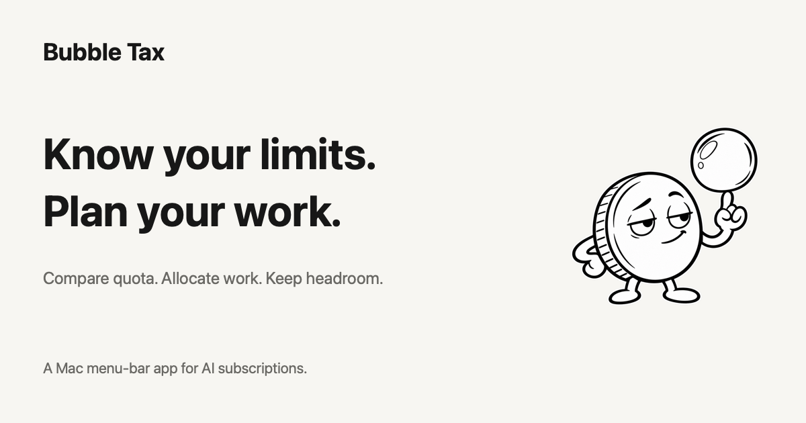
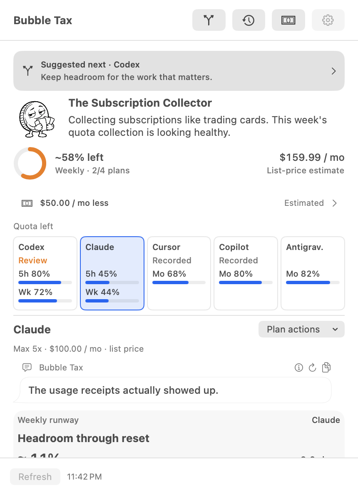
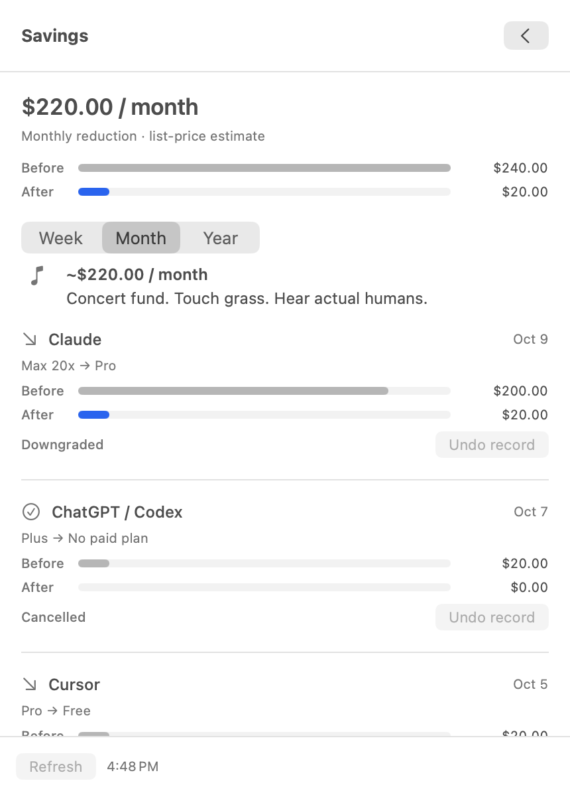

# Bubble Tax

**Stop sponsoring the AI bubble.**

A Mac menu-bar app for AI subscriptions you pay for and barely use.
See what is **left**, spot the plans worth reviewing, and keep a record when you cancel or downgrade.

[Download the Mac app](https://github.com/bubble-tax/bubble-tax.github.io/releases/download/v0.1.0/Bubble-Tax-0.1.0-macOS-arm64.zip) · [Website](https://bubble-tax.github.io/) · [Release notes](https://github.com/bubble-tax/bubble-tax.github.io/releases/tag/v0.1.0)



## Your quota is chilling. Your subscription money isn't.

One compact menu for **Claude, ChatGPT / Codex, Cursor, GitHub Copilot and Antigravity**.
Paid-plan quotas rotate in the menu bar every eight seconds. Open it to see each service's remaining limits, weekly-quota persona and a roast that follows the evidence.

<table>
  <tr>
    <td align="center"><strong>What you still haven't used</strong></td>
    <td align="center"><strong>What you stopped paying for</strong></td>
  </tr>
  <tr>
    <td valign="top">
<a href="assets/overview.png">
<picture>
  <source media="(prefers-color-scheme: dark)" srcset="assets/overview-dark.png">
  <source media="(prefers-color-scheme: light)" srcset="assets/overview.png">
  
</picture>
</a>
    </td>
    <td valign="top">
<a href="assets/savings.png">
<picture>
  <source media="(prefers-color-scheme: dark)" srcset="assets/savings-dark.png">
  <source media="(prefers-color-scheme: light)" srcset="assets/savings.png">
  
</picture>
</a>
    </td>
  </tr>
</table>

Actual macOS captures with illustrative sample data. Images follow your GitHub light or dark theme; click to view at full size.

## Left today. Unused when the window expires.

A quiet afternoon isn't a reason to cancel a plan. Bubble Tax keeps weekly and session limits separate, and records balances observed near reset so you can see repeated unused headroom over time.

<p align="center">
<a href="assets/unused-history.png">
<picture>
  <source media="(prefers-color-scheme: dark)" srcset="assets/unused-history-dark.png">
  <source media="(prefers-color-scheme: light)" srcset="assets/unused-history.png">
  
</picture>
</a>
</p>

Compare smaller plans, review the provider's cancellation options, then record the change **after you complete it**. Savings shows estimated monthly list-price reductions. Work plans use seat reviews and stay outside personal savings.

The point is to spend less, not burn more tokens to justify the bill.

## Try the preview

**v0.1.0 · Build 3 · Apple silicon · macOS 14+ · Python 3.9+**

1. [Download the ZIP](https://github.com/bubble-tax/bubble-tax.github.io/releases/download/v0.1.0/Bubble-Tax-0.1.0-macOS-arm64.zip), extract it and move **Bubble Tax.app** to Applications.
2. Open the app, then click **†** in the menu bar. There is no Dock window.
3. Open Settings to connect existing provider sessions or choose local log folders, then refresh.

This preview is **ad-hoc signed and not notarized**. If macOS blocks first launch, follow [Apple's instructions for opening an app from an unknown developer](https://support.apple.com/guide/mac-help/open-a-mac-app-from-an-unknown-developer-mh40616/mac). Installation details and checksums are on the [release page](https://github.com/bubble-tax/bubble-tax.github.io/releases/tag/v0.1.0). No Intel build is included.

## What the numbers mean

- Quotas come from available provider sessions. Local Claude / Codex logs and Pi coding-agent sessions add activity; token counts alone cannot establish subscription quota or who paid.
- ChatGPT's displayed quota is **Codex quota**, not every ChatGPT feature. Availability depends on the provider and authentication; missing readings stay unknown.
- History and completed-change records stay on your Mac. USD list prices are estimates, not your invoices, refunds or accumulated cash saved.
- Bubble Tax opens provider instructions. It does not cancel subscriptions or change billing on your behalf.

## This repository

This is the public landing-page and download repository. The app ZIP is attached to [Releases](https://github.com/bubble-tax/bubble-tax.github.io/releases); GitHub's automatic source archives contain the website, not the app source.

The page is plain HTML, CSS and JavaScript, with native screenshots, light/dark themes and an eight-second menu-bar preview. No framework or build step.

```bash
python3 -m http.server 8765 --bind 127.0.0.1
```

Open `http://127.0.0.1:8765`. Download and support destinations are in `config.js`. GitHub Pages serves this repository from the `main` branch root.

---

Coffee money? In this AI economy? [If you insist.](https://buymeacoffee.com/workromancer)
